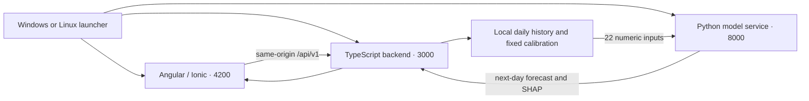

# ASTRA-SHIELD · Crew Health Console

**NASA Space Apps 2026 · local application prototype · Windows bundle and Linux/web paths**

The team's Angular/Ionic dashboard is connected to the TypeScript application backend and the existing Python model service. Record 15 daily measurements, build a personal calibration history, inspect trends, and receive a **next-day fatigue forecast with three SHAP reasons**.

The selected model is unchanged. Its training data is synthetic; NASA resources informed the project, not participant measurements. Forecasts and dashboard guidance are prototype outputs, not clinical validation or permission to perform a mission-critical task.


The teammate's dashboard design and Manrope typography are retained. Manrope is bundled locally for offline use. The added Alert demo tab, explicit connection controls, and mobile tab wrapping are documented integration changes.

## Start on Windows

For the self-contained Windows x64 installer, see **[Windows bundle instructions](desktop/README.md)** and the **[tester checklist](docs/FRIEND_TEST_CHECKLIST.md)**. The bundle includes Python, Node, and the unchanged model; it opens this same dashboard in your browser. Only a successful Windows build with matching smoke-test reports should be handed out as a tested executable.

The source launcher remains available for development:

Install **Python 3.12** and **Node.js 24 LTS (24.15+)**, extract the whole project, then:

1. Double-click **[Setup-Astra.cmd](Setup-Astra.cmd)** once to install dependencies.
2. Double-click **[Start-Demo.cmd](Start-Demo.cmd)** to run the presentation with clearly synthetic history, or **[Start-Astra.cmd](Start-Astra.cmd)** to run without adding example records.
3. The dashboard opens at **<http://127.0.0.1:4200>**. Keep the terminal open; **Ctrl+C** stops the stack.

These `.cmd` files are source launchers that require setup. The optional installer is built separately under `desktop/`. The dashboard remains a web application in both cases. Rehearse the installer on the team's actual Windows laptop before presenting.

## Run on Linux

With Python 3.12/venv and Node 24.15+ installed:

```bash
python3.12 scripts/setup.py
./start.sh --seed-demo
```

Use `bash start.sh --seed-demo` if a ZIP extraction removed executable permissions. Installation needs internet; normal inference runs locally on CPU and uses no external AI API.

**[Full setup, troubleshooting, storage, and presentation instructions](docs/RUNNING.md)** · **[Web development and future hosting](docs/WEB_DEPLOYMENT.md)**

## What the teammate built and what is connected

The frontend came from **Karam Eyad's [crew-health-console](https://github.com/Karam-Eyad/crew-health-console)**, supplied as a ZIP. Its dashboard, astronaut body map, daily form, trends, guide, and reaction-time prototype are retained. [Provenance and integration decisions](docs/INTEGRATION_HANDOFF.md) distinguish that work from the integration changes.

| Area | Current scope |
|---|---|
| Overview, Check-in, Trends, Guide | Angular/Ionic application using the backend's observations and forecasts |
| Calibration | First seven consecutive daily records; no prediction during calibration |
| Day eight onward | Existing model predicts tomorrow's category/index; actual TreeSHAP reasons |
| Errors and outages | Visible failures; acknowledged observations retained; exact latest-record retry |
| Reaction task | Custom 60-response prototype; quick 10-response mode is demonstration-only |
| Attention | Manual accuracy input; separate Flanker logic exists, but no complete attention-test UI |
| Measurement warnings | Frontend's illustrative guidance; not the Clinical Alert V2 engine |
| Alert demo | Five predefined fictional current-alert scenarios, independent of participant data and model calls |
| Clinical Alert V2 | Full engine deferred; its 14 medical acceptance scenarios are **not executed** by the demo |

The current-alert demo and tomorrow's forecast are deliberately separate. A low example forecast does not remove a severe current example alert. KSS and Samn–Perelli demo values are not converted to the model's custom fatigue score or sent as extra model inputs.

## Architecture



The frontend defaults to `/api/v1`. A development proxy connects it locally; a future web host can serve the same compiled frontend and proxy that path. Python remains a private backend service. There are no Electron or Windows-only frontend dependencies.

## Demonstrate without waiting a week

`Start-Demo.cmd` or `./start.sh --seed-demo` loads nine **historical synthetic** observations for `DEMO_SIM_001`: seven calibration days and two model requests. The displayed predictions are computed by the actual unchanged model. Existing participant history is preserved, never silently reset.

A separate, explicitly selected offline demo can display fixture examples without a backend. It is labeled as simulated, makes no new model predictions, and keeps additions only in the browser session. Connection failures do not silently switch real backend history to those fixtures.

## Project layout

```text
Setup-Astra.cmd / Start-Astra.cmd / Start-Demo.cmd
start.sh
scripts/                 Setup, supervised startup, integration checks
desktop/                 Bundled runtime, Windows installer/build, smoke tests
frontend/                Teammate's Angular/Ionic app plus integration fixes
ai/
  astra_shield_ml/        Model contract, inference and analysis code
  artifacts/             Unchanged selected model bundle
  data/                  Synthetic partitions, definitions and provenance
  integration/           TypeScript backend, client, Flanker prototype
  experimental/          Separate studies; none automatically promoted
  reports/               Evaluation, EDA and data audits
docs/                    Windows/Linux/web handoff and scope
integration-reports/     Application verification and preserved hashes
.local/                  Runtime history and logs; ignored by Git
```

## Model and research

The selected **26-feature Random Forest** has original validation **Macro-F1 0.5273** and historical test **Macro-F1 0.5285**. Macro-F1 is not accuracy. Historical High-class recall was 45.77%; results describe the simulator, not astronaut health performance. The original participant split is 70/15/15; the fatigue classifier's training partition contains 5,040 rows from 84 simulated people.

`fatigue_points` is a prototype index from classifier scores, not a medical probability. The separate regression score may disagree with the category. SHAP describes model contributions, not medical causes. The baseline, later measurement-extension study, and threshold study are documented separately; no experimental threshold or replacement model is used by this application.

- [Model setup, metrics, and input contract](ai/README.md)
- [Workflow and findings](ai/docs/FINDINGS.md)
- [Original standalone CSV](ai/data/astra_shield_synthetic_ml.csv)
- [Experimental archive](ai/experimental/README.md)
- [Frontend contract](ai/docs/FRONTEND_INTEGRATION.md)
- [Frontend details and source references](frontend/README.md)

## Verification and remaining work

The handoff includes frontend contract tests, launcher tests, and actual browser/backend/model integration checks. Results and their exact scope are recorded under [integration-reports](integration-reports/). They exercise fictional fixtures and application behavior; they do not validate medical decisions or improve the reported model accuracy.

Use the [friend's test checklist](docs/FRIEND_TEST_CHECKLIST.md) on the actual Windows laptop. Public deployment, authentication, multi-user storage, validated measurement protocols, the full clinical engine, and real human-data validation remain separate work. Nothing is published or deployed simply by running these launchers.

NASA background resources: [5 Hazards of Human Spaceflight](https://www.nasa.gov/hrp/hazards/), [Risks of Human Spaceflight](https://www.nasa.gov/hrp/risks/), and [Ongoing HRP Research](https://www.nasa.gov/hrp/ongoing-hrp-research/). These support the problem framing; they do not validate our synthetic data, model, or proposed alert cutoffs.
