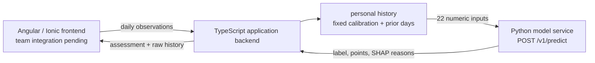

# ASTRA-SHIELD

**NASA Space Apps project · working AI prototype · application integration in progress**

ASTRA-SHIELD explores personal-baseline monitoring and next-day fatigue forecasting using sleep, physiological measurements, cognitive-task measurements, and self-reports. This repository contains the current AI service, a reviewed TypeScript backend integration, visual analysis, and the experimental findings.

**The application is not finished.** The Angular/Ionic frontend is not included in this snapshot, and the complete frontend → backend → model flow still needs to be integrated and tested. The checks completed so far cover the model contracts and local TypeScript-to-Python communication.

All included model-training records are **synthetic**. NASA resources informed the project background; these are not NASA astronaut measurements or clinically validated predictions.

## Start here

| Need | Go to |
|---|---|
| Run the model and local backend | [AI setup and usage](ai/README.md) |
| Understand the data, pipeline, and results | [Findings](ai/docs/FINDINGS.md) |
| Connect the frontend | [Frontend integration contract](ai/docs/FRONTEND_INTEGRATION.md) |
| See what is complete and what remains | [Project status](ai/docs/STATUS.md) |
| Inspect experimental models and comparisons | [Experimental archive](ai/experimental/README.md) |
| Review the EDA graphs | [Visual EDA report](ai/reports/visual_eda/ASTRA_SHIELD_visual_EDA.pdf) |

## Architecture



The TypeScript backend owns application routes and observation history. The Python service owns model inference and explanations. Experimental candidates are stored separately under [`ai/experimental/`](ai/experimental/) and are not automatically used by the API.

## Current decision

The demo retains the **26-feature Random Forest**. Its original validation Macro-F1 is **0.5273**. The later filtering candidate scored **0.5178** on that same validation partition, so it was not adopted. Other feature/history experiments also did not justify replacing the baseline. Scores from different validation and cross-validation setups are distinguished in the [findings](ai/docs/FINDINGS.md).

## Repository layout

```text
ai/
├── astra_shield_ml/      Python feature contract, models, API, and analysis code
├── artifacts/           Current demo model bundle and frozen manifests
├── data/                Synthetic partitions, definitions, and audit provenance
├── docs/                Findings, frontend contract, and remaining work
├── examples/            Model requests and responses
├── experimental/        Separate candidate artifacts and reproducible studies
├── integration/         TypeScript client and reviewed application backend
├── reports/             Baseline evaluation, EDA figures, and research review
└── tests/               Model and feature-contract checks
```

The next milestone is a reliable demonstration through the team's actual frontend, including calibration, prediction, history graphs, service outages, and recovery.
